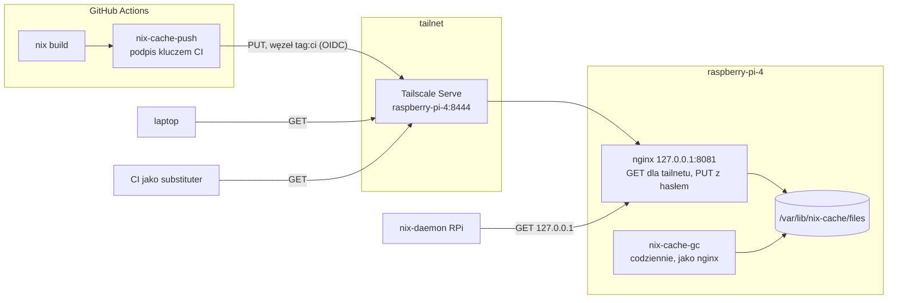

# Cache Nix w tailnecie na raspberry-pi-4

Projekt przed implementacją (AGENTS.md: nietrywialna architektura). Po
wdrożeniu ten plik znika, a trwałe fakty trafiają do nagłówka
`modules/hosts/nix-cache.nix`.

## Cel i decyzje

- Własny binary cache na RPi (SSD, ~745 GB wolne), z którego laptop, RPi i CI
  pobierają ścieżki zbudowane w GitHub Actions.
- Dostęp tylko w tailnecie: z RPi nic nie jest publiczne (inwariant zostaje).
  Tailnet działa z każdego miejsca, więc dla własnych urządzeń i CI to
  wystarcza.
- Obok Cachix, nie zamiast: Cachix zostaje pierwszym cache'em CI.
- Wysyłanie z każdego uruchomienia workflowów hostów w repo, tak jak dziś
  Cachix (PR-y z forków nie dostają sekretów).

## Układ

- Zwykły binary cache Nixa (`*.narinfo`, `nar/`): Nix sam wysyła do niego
  przez HTTP PUT (`nix copy --to https://…?secret-key=…`), a nginx (już na
  RPi) przyjmuje PUT modułem DAV. Nie ma nowego serwera.
- Attic odpada: podpisuje na serwerze, więc klucz leżałby na RPi, który jest
  mniej zaufany niż laptop. Przez tunel Cloudflare (próba z maja 2026) nie
  przechodziły też NAR-y większe niż 100 MB.

## Model zagrożeń

| Przejęte | Skutek | Dlaczego nie więcej |
|---|---|---|
| RPi (nginx, root) | cache zepsuty albo pusty, Nix bierze ścieżki z innych cache'y lub buduje | klucz podpisu nie istnieje na RPi; klient sprawdza podpis i NarHash |
| hasło PUT | śmieci albo nadpisane pliki | bez klucza podpisu klienci ich nie przyjmą; DELETE i MOVE są wyłączone |
| urządzenie tailnetu (telefon, agent na laptopie) | odczyt cache'a (same publiczne buildy) | PUT wymaga hasła |
| węzeł CI w tailnecie | dostęp do portu cache'a | polityka tailnetu: `tag:ci` tylko do `raspberry-pi-4:8444` |
| GitHub (repo, sekrety) | podpisane złośliwe ścieżki | nic nowego: `update` i tak wdraża z GitHuba |

## Elementy

- `customTop.nixCache` (`host`, `port`, `publicKey`, wyliczany `url`):
  wspólne dla modułów NixOS i generatora CI.
- `modules/hosts/nix-cache.nix`:
  - `rpi-nix-cache`: vhost nginx (127.0.0.1:8081, `dav_methods PUT`,
    `limit_except GET HEAD` z `auth_basic`, statyczne `nix-cache-info`),
    katalog `/var/lib/nix-cache` (root) z `files/` i `upload/` (nginx; bufor
    PUT w tym samym montowaniu co cache, bo `/tmp` RPi to tmpfs, a rename
    między dwoma `ReadWritePaths` daje EXDEV i blokujące kopiowanie),
    `customBot.tailscaleServe."8444"` z `users = [ ]`, `nix-cache-gc`,
    lokalny substituter.
  - `nixos-nix-cache`: substituter + klucz, `connect-timeout = 5`.
  - `packages.nix-cache-push`: domknięcie wyniku bez ścieżek z
    cache.nixos.org, podpis kluczem z `NIX_CACHE_SIGNING_KEY`, hasło przez
    netrc z `NIX_CACHE_PUSH_PASSWORD` (żadna z tych wartości nie trafia do
    linii poleceń).
- `github-actions.nix`: workflowy `nixos`, `raspberry-pi-4`
  i `cachyos-kernel-update` dostają `tailscale/github-action` (SHA,
  workload identity federation, `tag:ci`), substituter RPi i krok
  wysyłania; oba kroki z `continue-on-error`, więc RPi poza siecią nie
  psuje buildu.
- Sekret `nix-cache-htpasswd.age` (`ci:<openssl passwd -6>`, właściciel
  nginx).
- Test VM `checks.<system>.nix-cache`: PUT bez hasła 401, DELETE 405,
  wysyłka podpisana, klient z kluczem przyjmuje, z innym odrzuca, GC.

## Kroki ręczne

- Laptop: klucz `nix key generate-secret` -> sekret GitHuba
  `NIX_CACHE_SIGNING_KEY`, publiczny do `args.nix`; hasło -> sekret
  `NIX_CACHE_PUSH_PASSWORD` i hash do `nix-cache-htpasswd.age`.
- Panel Tailscale: `tag:ci` w `tagOwners`; federated identity dla GitHub
  Actions (OIDC, scope `auth_keys`, tag `tag:ci`) -> sekrety
  `TS_OAUTH_CLIENT_ID`, `TS_AUDIENCE`; reguła ogólna z
  `src: ["autogroup:member"]` zamiast `"*"` oraz `tag:ci` -> RPi `tcp:8444`.
