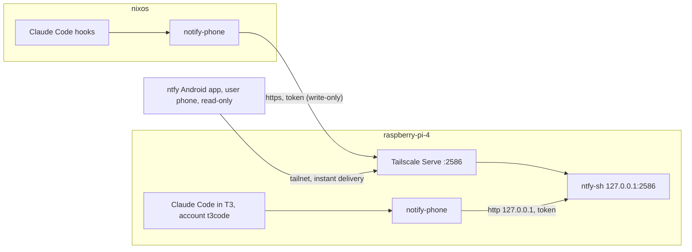

# Push notifications to the phone (ntfy on the RPi)

Goal: coding agents (Claude Code hooks, `notify-phone` from any agent) send
push notifications to the owner's phone without anything reaching the
internet.

- Server: nixpkgs `services.ntfy-sh` on the RPi, `listen-http`
  127.0.0.1:2586, Tailscale Serve on tailnet port 2586
  (`customBot.tailscaleServe`, local connections only from root and
  `t3code`), `auth-default-access = deny-all`, web UI off, in
  `customBot.lockdownServices`.
- Users and tokens are declarative (`NTFY_AUTH_USERS`, `NTFY_AUTH_TOKENS` from
  agenix `ntfy-server.age`, root `0400`, read by systemd as
  `EnvironmentFile`); ACLs in `settings.auth-access`: `phone` read-only,
  `claude` write-only on one topic. Publishers cannot read, so the less
  trusted RPi account `t3code` cannot read the laptop's notifications.
- Clients: `notify-phone [-t title] [-p priority] message` (curl, token
  header from `ntfy-token.age` via `-H @file`, never on the command line):
  laptop owner `dinosaur`, RPi owner `t3code`.
- Claude Code: `/etc/claude-code/managed-settings.d/ntfy.json` with hooks
  `Notification` (`permission_prompt|elicitation_dialog`, default priority)
  and `Stop` (low priority, the first 300 characters of
  `last_assistant_message`). The hook exits 0 on any failure.
- Skill `notify-phone` tells every agent the command exists.
- Residual risk: notification text from laptop sessions is cached on the RPi
  for 12 h (`cache-duration` default), so RPi root can read it; that is why
  the Stop message is truncated.
