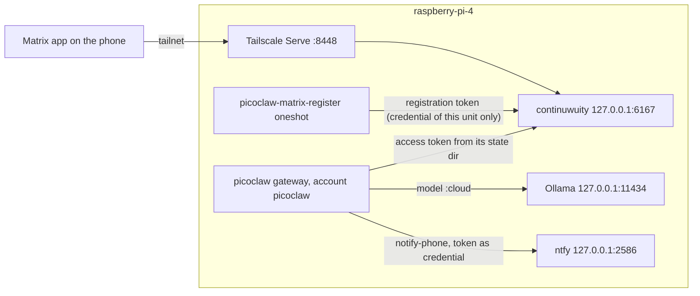

# Picoclaw assistant on the RPi, chat over Matrix

Goal: an always-on personal assistant (picoclaw, `llm-agents`) on the RPi that
the owner talks to from the phone over Matrix and that sends push
notifications through the existing ntfy server. Nothing reaches the internet
except the model API that Ollama already uses.

- Homeserver: nixpkgs `services.matrix-continuwuity` (Rust, RocksDB, fits
  4 GB RAM), `server_name` = `<RPi>.<tailnet>`, 127.0.0.1:6167, Tailscale
  Serve on tailnet port 8448 (`users = null`: Matrix authenticates every
  request), federation off, no trusted key servers, no announcement check.
  Registration only with a token (`registration_token_file`, agenix
  `continuwuity-registration-token.age`, `LoadCredential`). In
  `customBot.lockdownServices`.
- Bot account: oneshot `picoclaw-matrix-register` (account `picoclaw`, the
  only unit with the registration token) registers `@picoclaw` once through
  the registration-token UIA flow and stores the access token in picoclaw's
  state directory. No secret needs a value from the user.
- Picoclaw: `picoclaw gateway` as system account `picoclaw`, config
  `config.json` generated by Nix (schema version 3, so it is never migrated
  or written back), completed at start by a script running as `picoclaw`:
  access token in `PICOCLAW_CHANNELS_MATRIX_ACCESS_TOKEN`, E2EE pickle key
  generated once into the state directory (it only protects the crypto
  database that lies next to it). Matrix channel with `allow_from` = the
  owner only, model from `ai.models` through local Ollama, skill
  registries off (no runtime-fetched code), skills from `ai.skills` through
  the harness (`/etc/picoclaw/skills`, linked as its global skills dir).
  In `customBot.lockdownServices`.
- Notifications: `notify-phone` reads the token from
  `$CREDENTIALS_DIRECTORY/ntfy-token` when present (the existing
  `ntfy-token.age` passed with `LoadCredential`), otherwise from the agenix
  path as before. Picoclaw is added to the local users of ntfy's port.
- Not done: push for Matrix messages through UnifiedPush/ntfy. The
  homeserver would have to reach ntfy under the RPi's own tailnet address,
  which the firewall rejects on purpose (`hosts/tailscale.nix`); it needs an
  explicit owner exception and anonymous write on `up*` topics, a separate
  decision.
