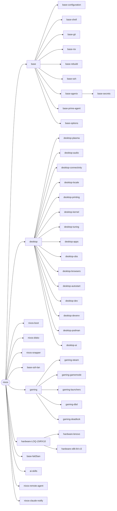
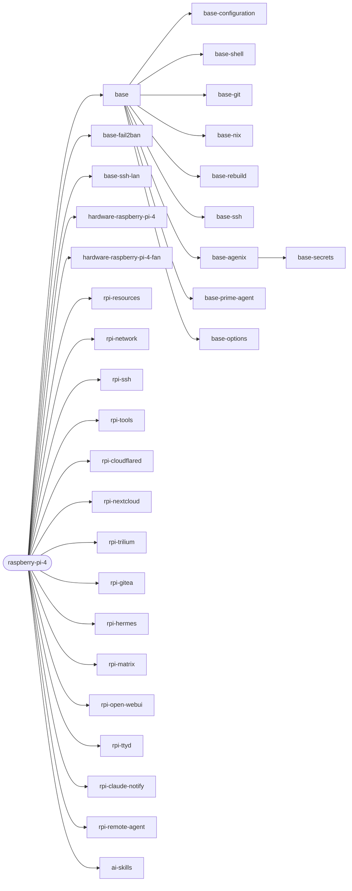
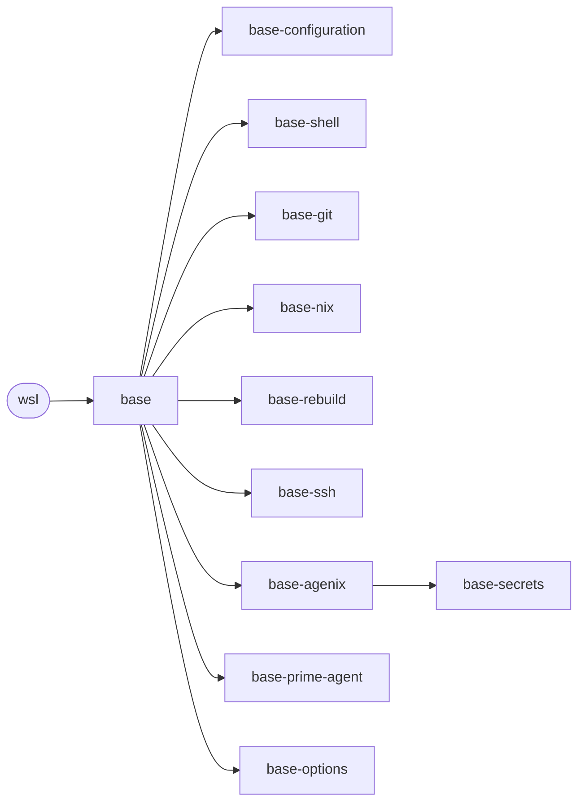

<!-- Generated by modules/docs.nix (`nix run .#sync-docs`, pre-commit hook sync-docs). Do not edit. -->

# Hosts

Declared in the host registry (`modules/hosts/registry.nix`); each host is `nixosConfigurations.<name>` and the target of its `update` aliases.

| Host | Platform | CI build on `v*` tags | Modules |
|---|---|---|---|
| [`nixos`](#nixos) | `x86_64-linux` | no (PR, manual) | 45 |
| [`raspberry-pi-4`](#raspberry-pi-4) | `aarch64-linux` | yes | 31 |
| [`wsl`](#wsl) | `x86_64-linux` | yes | 12 |

## nixos

Host nixos: laptop Lenovo LOQ 15IRX10 (i5-13450HX + RTX 5060, PRIME offload) — stacja robocza z Plasmą 6 i grami, użytkownik dinosaur. Tu jest tylko to, co czyni go tą maszyną: wpis rejestru, tożsamość (hostname, stateVersion, konto), dysk (disko.nix, snapper.nix), rozruch (boot.nix); SSH tylko z LAN-u daje base-ssh-lan. Funkcje stacji roboczej: modules/desktop/, gry: modules/gaming/, sprzęt: modules/hardware/LOQ-15IRX10/.

- `ai-skills` — [skills/default.nix](../../modules/skills/default.nix)
- `base` — [hosts/base/default.nix](../../modules/hosts/base/default.nix)
- `base-agenix` — [hosts/base/agenix.nix](../../modules/hosts/base/agenix.nix)
- `base-configuration` — [hosts/base/configuration.nix](../../modules/hosts/base/configuration.nix)
- `base-fail2ban` — [hosts/base/fail2ban.nix](../../modules/hosts/base/fail2ban.nix)
- `base-git` — [hosts/base/git.nix](../../modules/hosts/base/git.nix)
- `base-nix` — [hosts/base/nix.nix](../../modules/hosts/base/nix.nix)
- `base-options` — [hosts/base/options.nix](../../modules/hosts/base/options.nix)
- `base-prime-agent` — [hosts/base/prime-agent.nix](../../modules/hosts/base/prime-agent.nix)
- `base-rebuild` — [hosts/base/rebuild.nix](../../modules/hosts/base/rebuild.nix)
- `base-secrets` — [hosts/base/secrets.nix](../../modules/hosts/base/secrets.nix)
- `base-shell` — [hosts/base/shell.nix](../../modules/hosts/base/shell.nix)
- `base-ssh` — [hosts/base/ssh.nix](../../modules/hosts/base/ssh.nix)
- `base-ssh-lan` — [hosts/base/ssh-lan.nix](../../modules/hosts/base/ssh-lan.nix)
- `desktop` — [desktop/default.nix](../../modules/desktop/default.nix)
- `desktop-ai` — [desktop/ai.nix](../../modules/desktop/ai.nix)
- `desktop-apps` — [desktop/apps.nix](../../modules/desktop/apps.nix)
- `desktop-audio` — [desktop/audio.nix](../../modules/desktop/audio.nix)
- `desktop-autostart` — [desktop/autostart.nix](../../modules/desktop/autostart.nix)
- `desktop-browsers` — [desktop/browsers.nix](../../modules/desktop/browsers.nix)
- `desktop-connectivity` — [desktop/connectivity.nix](../../modules/desktop/connectivity.nix)
- `desktop-dev` — [desktop/dev.nix](../../modules/desktop/dev.nix)
- `desktop-devenv` — [desktop/devenv.nix](../../modules/desktop/devenv.nix)
- `desktop-kernel` — [desktop/kernel.nix](../../modules/desktop/kernel.nix)
- `desktop-locale` — [desktop/locale.nix](../../modules/desktop/locale.nix)
- `desktop-obs` — [desktop/obs.nix](../../modules/desktop/obs.nix)
- `desktop-plasma` — [desktop/plasma.nix](../../modules/desktop/plasma.nix)
- `desktop-podman` — [desktop/podman.nix](../../modules/desktop/podman.nix)
- `desktop-printing` — [desktop/printing.nix](../../modules/desktop/printing.nix)
- `desktop-tuning` — [desktop/tuning.nix](../../modules/desktop/tuning.nix)
- `gaming` — [gaming/default.nix](../../modules/gaming/default.nix)
- `gaming-dbd` — [gaming/dbd.nix](../../modules/gaming/dbd.nix)
- `gaming-deadlock` — [gaming/deadlock.nix](../../modules/gaming/deadlock.nix)
- `gaming-gamemode` — [gaming/gamemode.nix](../../modules/gaming/gamemode.nix)
- `gaming-launchers` — [gaming/launchers.nix](../../modules/gaming/launchers.nix)
- `gaming-steam` — [gaming/steam.nix](../../modules/gaming/steam.nix)
- `hardware-LOQ-15IRX10` — [hardware/LOQ-15IRX10/default.nix](../../modules/hardware/LOQ-15IRX10/default.nix)
- `hardware-lenovo` — [hardware/lenovo.nix](../../modules/hardware/lenovo.nix)
- `hardware-x86-64-v3` — [hardware/x86-64-v3.nix](../../modules/hardware/x86-64-v3.nix)
- `nixos` — [hosts/nixos/default.nix](../../modules/hosts/nixos/default.nix)
- `nixos-boot` — [hosts/nixos/boot.nix](../../modules/hosts/nixos/boot.nix)
- `nixos-claude-notify` — [hosts/claude-notify.nix](../../modules/hosts/claude-notify.nix)
- `nixos-disko` — [hosts/nixos/disko.nix](../../modules/hosts/nixos/disko.nix)
- `nixos-remote-agent` — [hosts/remote-agent.nix](../../modules/hosts/remote-agent.nix)
- `nixos-snapper` — [hosts/nixos/snapper.nix](../../modules/hosts/nixos/snapper.nix)

## raspberry-pi-4

Host raspberry-pi-4: domowy serwer (RPi 4B, 4 GB RAM, dysk SSD po USB), usługi wystawione wyłącznie przez Cloudflare Tunnel (cloudflared.nix). Tu: wpis rejestru, tożsamość (hostname, stateVersion, konto) i lista modułów hosta; płytka i wentylator: modules/hardware/raspberry-pi-4/. Agregat importuje też base, bo obraz SD (sd-image.nix) składa go poza rejestrem hostów.

- `ai-skills` — [skills/default.nix](../../modules/skills/default.nix)
- `base` — [hosts/base/default.nix](../../modules/hosts/base/default.nix)
- `base-agenix` — [hosts/base/agenix.nix](../../modules/hosts/base/agenix.nix)
- `base-configuration` — [hosts/base/configuration.nix](../../modules/hosts/base/configuration.nix)
- `base-fail2ban` — [hosts/base/fail2ban.nix](../../modules/hosts/base/fail2ban.nix)
- `base-git` — [hosts/base/git.nix](../../modules/hosts/base/git.nix)
- `base-nix` — [hosts/base/nix.nix](../../modules/hosts/base/nix.nix)
- `base-options` — [hosts/base/options.nix](../../modules/hosts/base/options.nix)
- `base-prime-agent` — [hosts/base/prime-agent.nix](../../modules/hosts/base/prime-agent.nix)
- `base-rebuild` — [hosts/base/rebuild.nix](../../modules/hosts/base/rebuild.nix)
- `base-secrets` — [hosts/base/secrets.nix](../../modules/hosts/base/secrets.nix)
- `base-shell` — [hosts/base/shell.nix](../../modules/hosts/base/shell.nix)
- `base-ssh` — [hosts/base/ssh.nix](../../modules/hosts/base/ssh.nix)
- `base-ssh-lan` — [hosts/base/ssh-lan.nix](../../modules/hosts/base/ssh-lan.nix)
- `hardware-raspberry-pi-4` — [hardware/raspberry-pi-4/default.nix](../../modules/hardware/raspberry-pi-4/default.nix)
- `hardware-raspberry-pi-4-fan` — [hardware/raspberry-pi-4/fan.nix](../../modules/hardware/raspberry-pi-4/fan.nix)
- `raspberry-pi-4` — [hosts/raspberry-pi-4/default.nix](../../modules/hosts/raspberry-pi-4/default.nix)
- `rpi-claude-notify` — [hosts/claude-notify.nix](../../modules/hosts/claude-notify.nix)
- `rpi-cloudflared` — [hosts/raspberry-pi-4/cloudflared.nix](../../modules/hosts/raspberry-pi-4/cloudflared.nix)
- `rpi-gitea` — [hosts/raspberry-pi-4/gitea.nix](../../modules/hosts/raspberry-pi-4/gitea.nix)
- `rpi-hermes` — [hosts/raspberry-pi-4/hermes.nix](../../modules/hosts/raspberry-pi-4/hermes.nix)
- `rpi-matrix` — [hosts/raspberry-pi-4/matrix.nix](../../modules/hosts/raspberry-pi-4/matrix.nix)
- `rpi-network` — [hosts/raspberry-pi-4/network.nix](../../modules/hosts/raspberry-pi-4/network.nix)
- `rpi-nextcloud` — [hosts/raspberry-pi-4/nextcloud.nix](../../modules/hosts/raspberry-pi-4/nextcloud.nix)
- `rpi-open-webui` — [hosts/raspberry-pi-4/open-webui.nix](../../modules/hosts/raspberry-pi-4/open-webui.nix)
- `rpi-remote-agent` — [hosts/remote-agent.nix](../../modules/hosts/remote-agent.nix)
- `rpi-resources` — [hosts/raspberry-pi-4/resources.nix](../../modules/hosts/raspberry-pi-4/resources.nix)
- `rpi-ssh` — [hosts/raspberry-pi-4/ssh.nix](../../modules/hosts/raspberry-pi-4/ssh.nix)
- `rpi-tools` — [hosts/raspberry-pi-4/tools.nix](../../modules/hosts/raspberry-pi-4/tools.nix)
- `rpi-trilium` — [hosts/raspberry-pi-4/trilium.nix](../../modules/hosts/raspberry-pi-4/trilium.nix)
- `rpi-ttyd` — [hosts/raspberry-pi-4/ttyd.nix](../../modules/hosts/raspberry-pi-4/ttyd.nix)

## wsl

Host wsl: NixOS-WSL na Windowsie (sterownik GPU z Windowsa, skróty aplikacji w menu Start). resolv.conf generuje WSL, więc serwery DNS z base są tu czyszczone. WSL nie jest odbiorcą agenix: sekrety użytkownika z base-secrets są zadeklarowane, ale się tu nie odszyfrowują.

- `base` — [hosts/base/default.nix](../../modules/hosts/base/default.nix)
- `base-agenix` — [hosts/base/agenix.nix](../../modules/hosts/base/agenix.nix)
- `base-configuration` — [hosts/base/configuration.nix](../../modules/hosts/base/configuration.nix)
- `base-git` — [hosts/base/git.nix](../../modules/hosts/base/git.nix)
- `base-nix` — [hosts/base/nix.nix](../../modules/hosts/base/nix.nix)
- `base-options` — [hosts/base/options.nix](../../modules/hosts/base/options.nix)
- `base-prime-agent` — [hosts/base/prime-agent.nix](../../modules/hosts/base/prime-agent.nix)
- `base-rebuild` — [hosts/base/rebuild.nix](../../modules/hosts/base/rebuild.nix)
- `base-secrets` — [hosts/base/secrets.nix](../../modules/hosts/base/secrets.nix)
- `base-shell` — [hosts/base/shell.nix](../../modules/hosts/base/shell.nix)
- `base-ssh` — [hosts/base/ssh.nix](../../modules/hosts/base/ssh.nix)
- `wsl` — [hosts/wsl/default.nix](../../modules/hosts/wsl/default.nix)
